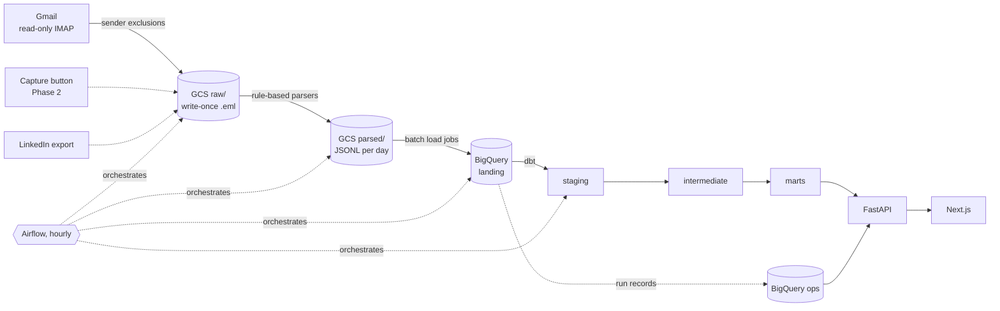
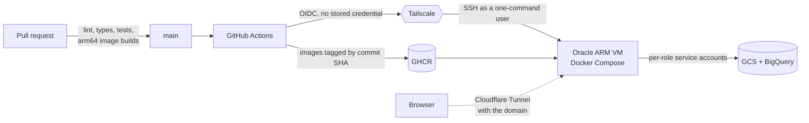

# TraceMail

[](https://github.com/ErenReyhanlioglu/tracemail/actions/workflows/ci.yml)


[](LICENSE)

**An hourly data pipeline that turns a job-search mailbox into a tracked,
measured, and explainable record of every application.**

TraceMail reads a job-application mailbox (read-only), stores every relevant
mail unchanged in a data lake, parses it with versioned rule-based parsers,
loads it into a layered BigQuery warehouse, and models applications, postings,
and replies with dbt. Later phases add an LLM matching report with verifiable
evidence, a hand-labeled evaluation gate in CI, and a public health panel where
the system reports on itself.

It runs on real data only. There is no demo dataset: the public panel shows
real system metrics or nothing.

**Status:** Phase 1 (the data foundation) runs in production on an Oracle
Cloud ARM VM, and every merge to `main` deploys itself. The public site goes
live when its domain is active. See [Status](#status).

## Why this project

It is built as a working system, not a tutorial: real mail, real cloud
accounts, real costs, and real failure modes. Every significant choice is
recorded as an [Architecture Decision Record](docs/adr/README.md) with the
alternatives that were rejected and the sources it relied on, and every
pipeline step measures its own time, volume, operations, and cost
([ADR-0017](docs/adr/0017-every-step-measures-time-volume-operations-and-cost.md)).
Claims in this README link to the record that measured them.

## Architecture



| Layer | Role | Key property |
|---|---|---|
| `raw/` (GCS) | Original mail bytes | Write-once, deterministic keys: a rerun is a no-op |
| `parsed/` (GCS) | What the parser understood, as JSONL | Rewritten per day; every row carries parser name and version |
| `landing` (BigQuery) | Parser output as tables | Schema generated from Pydantic models; each load replaces one day's partition |
| `staging` / `intermediate` / `marts` | dbt models | Deduplication across sources, star schema, data tests |
| `ops` (BigQuery) | Run records and quality metrics | Feeds the public health panel |

The whole analytic layer can be rebuilt from `raw/` after a parser change.

## Production and deployment



- **No open inbound port.** The VM's firewall has no ingress rule.
  Administration and deploys arrive over Tailscale; public traffic will arrive
  through an outbound Cloudflare Tunnel
  ([ADR-0016](docs/adr/0016-self-host-web-on-vm-behind-cloudflare-tunnel.md)).
- **No stored deploy credential.** The deploy job joins the tailnet with
  GitHub's OIDC token. Tailscale trusts only tokens for this repository's
  `production` environment, matched by the owner's and repository's
  immutable IDs, and the environment accepts only `main`
  ([ADR-0012](docs/adr/0012-build-in-ci-ghcr-and-push-deploy-over-tailscale.md)).
- **A deploy identity that can only deploy.** On the VM the deploy user's
  login shell accepts one command, `deploy <commit SHA>`, and its single sudo
  rule runs one script. The restriction is tested in CI on every pull request
  and checked again against the live VM before every deploy; each deploy ends
  with a smoke test through the web app to BigQuery
  ([ADR-0035](docs/adr/0035-deploy-user-restricted-by-login-shell-and-sudo.md)).
- **Least privilege in the cloud.** Separate dev and prod projects; one
  service account per role (ingestion, transform, API) with dataset-level
  grants and no project-wide data role
  ([infra/gcp](infra/gcp/README.md)).
- **Reproducible releases.** Images are built natively on arm64 runners and
  tagged with the commit SHA; the VM checks out the same commit, so code,
  DAGs, and images always match. Rollback is re-running an earlier deploy.

## Engineering highlights

- **Idempotent by construction.** Ingestion works on date windows with no
  stored watermark, raw writes use a create-only precondition, and loads
  replace exactly one date partition. Loading the same range three times
  produced identical tables, verified with order-independent content
  fingerprints.
- **Privacy at the door.** Personal-account and newsletter senders on an
  exclusion list are never stored and never logged beyond a count. The
  mailbox is opened read-only and fetched with `BODY.PEEK`, so nothing is ever
  marked as read; a test enforces both. A test also asserts that no public
  API response schema contains a private field.
- **Parsing failures are data.** Every message yields exactly one parse
  outcome (parsed, failed, or unclaimed with a reason), so parse quality is a
  metric, not a log line. Templates are detected by a language-independent
  marker, and unrecognized lines are kept rather than dropped.
- **Measured, not assumed.** Each step returns a result model with durations,
  record counts, bytes, and per-service operation counts, written to
  `ops.pipeline_runs` in a shape aligned with data observability pillars and
  OpenLineage
  ([ADR-0020](docs/adr/0020-run-records-follow-observability-frameworks.md)).
  Optimizations are reported with before and after numbers.
- **Cost-aware on free tiers.** Batch load jobs instead of streaming inserts,
  `maximum_bytes_billed` on every query, no BigQuery Storage Read API, and a
  rule that any free-tier allowance projected above 85% must be optimized
  before new work uses it
  ([ADR-0021](docs/adr/0021-gcs-operations-under-hourly-runs.md),
  [ADR-0030](docs/adr/0030-gcs-class-a-headroom.md)).

## Measured so far

On real mail, October 2026:

| What | Result | Source |
|---|---|---|
| Parse outcomes, 2026-07-10 to 2026-10-11 (dev) | 725 messages: 628 parsed, 0 failed, 97 unclaimed (senders without a parser, kept as "other") | `landing.message_parse_outcomes` |
| Ingesting a 7-day window (114 messages) | 55.3 s → 5.9 s; IMAP commands 115 → 3 after batching | [ADR-0017](docs/adr/0017-every-step-measures-time-volume-operations-and-cost.md) |
| Loading 24 partitions into BigQuery | 78.5 s → 15.5 s with concurrent load jobs | [ADR-0019](docs/adr/0019-landing-load-schema-from-models-and-partition-replace.md) |
| Repeated loads of the same range | Identical row counts and content fingerprints, 3 of 3 runs | [ADR-0019](docs/adr/0019-landing-load-schema-from-models-and-partition-replace.md) |
| Airflow image build on arm64 | 3 min without cache → 20 s with the layer cache | [infra/vm](infra/vm/README.md#continuous-deployment) |
| Deploy job, merge to running stack | 4 min 5 s for the first deploy, 1 min 47 s for the next | [infra/vm](infra/vm/README.md#continuous-deployment) |

## Competencies and where to find them

The project exists to demonstrate the competencies listed in
[SUMMARY.md](SUMMARY.md#competencies-the-project-must-deliver). Where each one
can be checked today:

| Competency | Evidence | State |
|---|---|---|
| Workflow orchestration | Hourly DAG with retries, backfill, and dbt through Cosmos: [`tracemail_ingest.py`](apps/airflow/dags/tracemail_ingest.py), [ADR-0029](docs/adr/0029-cosmos-watcher-execution-mode.md) | Built |
| Incremental ingestion | Date-window IMAP with no watermark: [ADR-0007](docs/adr/0007-date-window-ingestion-and-read-only-mailbox.md) | Built |
| Raw data layer | Write-once raw zone, replayable parsed zone: [ADR-0006](docs/adr/0006-raw-parsed-landing-data-flow.md), [ADR-0018](docs/adr/0018-parsed-zone-uses-partition-overwrite.md) | Built |
| Warehouse and data modeling | Layered datasets, star schema, cross-source dedup: [`dbt/models`](dbt/models/marts), [ADR-0024](docs/adr/0024-application-status-model.md) | Built |
| Data quality | dbt tests, parse outcomes per message, 90% test coverage floor | Built |
| Cloud fundamentals | Least-privilege setup script: [`setup-project.sh`](infra/gcp/setup-project.sh), [ADR-0009](docs/adr/0009-vm-to-gcp-auth-with-service-account-keys.md), [ADR-0010](docs/adr/0010-separate-gcp-projects-for-dev-and-prod.md) | Built |
| CI/CD | [`ci.yml`](.github/workflows/ci.yml): checks, dbt build and data tests on dev data through Workload Identity Federation ([ADR-0037](docs/adr/0037-dbt-build-in-ci-on-dev-data.md)), arm64 images, deploy with pre-deploy checks | Built; LLM eval gate in Phase 2 |
| Data privacy and access separation | Exclusion at ingestion, public/private API test: [ADR-0025](docs/adr/0025-sender-exclusion-list-instead-of-allowlist.md), [`test_privacy.py`](apps/api/tests/test_privacy.py) | Built; share links in Phase 3 |
| API design | FastAPI with owner login and cached reads: [ADR-0032](docs/adr/0032-owner-login-implementation.md) | Built |
| Portable deployment | One Compose file for local and the VM: [`compose.yaml`](infra/compose.yaml) | Built |
| Live monitoring | Run records and dbt results in `ops`: [ADR-0020](docs/adr/0020-run-records-follow-observability-frameworks.md), [ADR-0023](docs/adr/0023-dbt-run-metrics-from-artifacts-and-job-labels.md) | Recorded; health panel in Phase 3 |
| Managed AI service, structured LLM output, LLM evaluation | Provider interface, schema-validated output, golden set, MLflow | Phase 2 |
| Incident management | Incident log on the health panel | Phase 3 |

## Status

| Phase | Scope | State |
|---|---|---|
| 1. Core | Ingestion, parsing, warehouse, dbt models, Airflow, owner login, application and posting lists, production deployment | Running in production; public domain and LinkedIn history pending ([roadmap](docs/roadmap.md)) |
| 2. Intelligence | Reply classification, evidence-quoted match reports, golden set, MLflow comparison, CI eval gate | Planned |
| 3. Interface | Public health panel, share links, full private sections | Planned |
| 4. Optional | Rough fit ranking with a local embedding model, follow-up drafts | Planned |

Phase 1 has no LLM by design: the data foundation comes first.

## Tech stack

| Area | Tools |
|---|---|
| Languages | Python 3.12, SQL, TypeScript |
| Ingestion and storage | IMAP, Google Cloud Storage |
| Warehouse and modeling | BigQuery, dbt |
| Orchestration | Apache Airflow 3.3 (LocalExecutor), Astronomer Cosmos |
| Serving | FastAPI, Next.js |
| Infrastructure | Docker Compose, Oracle Cloud ARM VM, Tailscale, Cloudflare Tunnel |
| Quality | pytest (90% coverage floor), dbt tests, ruff, mypy `--strict`, shellcheck |
| CI/CD | GitHub Actions (SHA-pinned actions, native arm64 runners), GHCR, keyless OIDC to Tailscale and to GCP (Workload Identity Federation) |
| LLM (Phase 2) | Gemini through Google Cloud, Pydantic structured output, MLflow |

## Repository layout

```
packages/pipeline/   IMAP fetch, sender exclusions, raw writes, parsers, loads
packages/llm/        Phase 2: provider interface, prompts, call logging, budget
packages/evals/      Phase 2: golden set, evaluation runner
apps/airflow/        DAGs (wiring only) and image
apps/api/            FastAPI service
apps/web/            Next.js app
dbt/                 dbt project with its own environment
infra/               Docker Compose, GCP project setup, VM setup and deploy scripts
docs/                ADRs and roadmap
```

## Development

Requires [uv](https://docs.astral.sh/uv/), [just](https://just.systems/), and
Docker.

```sh
uv sync          # create the environment from uv.lock
just check       # lint, typecheck, and test
just up          # the full stack locally: Airflow, API, web app
just --list      # every available command
```

Running the pipeline needs a GCP project, a mailbox app password, and a sender
exclusion list; see [.env.example](.env.example) for the settings it reads.

## Documentation

- [SUMMARY.md](SUMMARY.md): product scope, phases, out-of-scope list, known
  limits, and the competencies the project is built to demonstrate
- [docs/adr/](docs/adr/README.md): every architecture decision with its
  alternatives and sources
- [docs/roadmap.md](docs/roadmap.md): build order, current step, and what is
  still unverified
- [infra/vm/README.md](infra/vm/README.md): production VM, deploy user, and
  continuous deployment, with what was verified on the VM

## License

[MIT](LICENSE)
